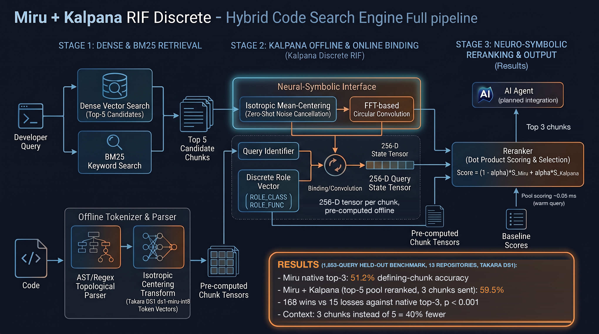

# Miru + Kalpana Discrete RIF: Sub-Millisecond Neuro-Symbolic Code Reranking

📄 **Whitepaper:** [Kalpana-RIF Discrete: Neuro-Symbolic Reranking of Code-Search Candidates for Agentic Retrieval Pipelines](paper/Miru_Kalpana_Discrete_RIF_Whitepaper.pdf) ([LaTeX source](paper/Miru_Kalpana_Discrete_RIF_Whitepaper.tex))

Kalpana Discrete RIF is a structural reranker that runs on top of [Miru](https://www.npmjs.com/package/@takara-ai/miru-code)'s hybrid (BM25 + dense) code search. Miru itself is not modified.

Each code chunk becomes a set of *(role, identifier)* pairs, for example `ROLE_FUNC ⊛ "resource slice indexers"`. Those pairs are bound with FFT circular convolution and bundled into a single 384-D tensor at index time. At query time, Miru's candidates are rescored by a dot product against a structural query tensor ("where is *X* **defined**"). The two rankings are then fused.



*Pipeline overview. The figures in the diagram's "Performance Evolution" box come from different runs (150- and 500-query sets, K=25 and K=5 pools). The tables below are the authoritative 500-query numbers. The final pipeline reranks Miru's native topK=5 candidates rather than a top-25 pool.*

---

## What this is (and isn't)

> [!IMPORTANT]
> This repository is a **research benchmark and reference implementation**. It is **not** a drop-in replacement for Miru. Miru ships as a `miru` CLI and an MCP server that gives Claude Code, Cursor and other agents a `search` tool. This repo has **no CLI and no MCP tool yet**. Kalpana runs *after* Miru, in Python, on Miru's exported results.

| | Miru | Miru + Kalpana (this repo) |
|---|---|---|
| Install / run | `bun add -g @takara-ai/miru-code`, `miru setup`, then `miru` CLI / MCP | `npm install` + `pip install -r requirements.txt`, then Python scripts |
| Where reranking happens | Inside Miru | **Outside Miru, afterwards.** Miru is used unmodified. |
| Languages | Many | Go benchmarked in depth (client-go, 500 queries). Also run on Miru's own suites: CodeSearchNet (Go, Java, JS, PHP, Python, Ruby) and the curated A/B repos (TypeScript, Rust, Elixir). See [Multi-language results](#multi-language-results-mirus-own-benchmark-suites). |
| Index | Any repo | Scripts are wired to `eval-repos/client-go` |

### How it fits together

```
your query ──► Miru search (topK=5, unmodified, Bun)
                 │  scripts/miru_candidates.ts → candidates JSON (path, lines, content, score)
                 ▼
             Kalpana (Python)
                 ├─ offline: chunk → (role, identifier) pairs → 384-D tensor   (once, at index time)
                 ├─ online:  query → structural tensor → dot product vs pool   (~0.035 ms + query encode)
                 └─ fuse Miru order + Kalpana order with RRF → top-3 to the LLM
```

### Using the reranker on Miru output

After step 3 of [Reproduce](#reproduce-the-500-query-benchmark) has produced a candidates file, run this from the repo root:

```python
import json
import numpy as np
from miru_kalpana_reranker import KalpanaReranker
from miru_kalpana.benchmark_kalpana_fusion import go_pairs, query_pairs

rr = KalpanaReranker()                       # loads MiniLM once (~20 s)
pools = json.load(open(".bench/kalpana/candidates.minilm-l6-256.all500.k5.json"))
row = pools["queries"][0]                    # one query's Miru topK=5 result
cands = row["candidates"]                    # [{file_path, start_line, content, score}, ...] in Miru order

query = "resource slice indexers"            # identifier words, as in the benchmark
q_t = rr.index_chunk(query_pairs(query))
c_t = [rr.index_chunk(p) if (p := go_pairs(c["content"])) else np.zeros(384) for c in cands]
k_rank = {i: r for r, (i, _) in enumerate(rr.rerank(q_t, c_t))}

# RRF fusion of Miru's order and Kalpana's order (c = 60), keep the top 3
fused = sorted(range(len(cands)), key=lambda i: -(1 / (61 + i) + 1 / (61 + k_rank[i])))
for i in fused[:3]:
    print(f'{cands[i]["file_path"]}:{cands[i]["start_line"]}')
# informers/resource/v1/resourceslice.go:69
# informers/resource/v1beta1/resourceslice.go:69
# informers/resource/v1beta2/resourceslice.go:69
```

This example builds chunk tensors on the fly for clarity. In production, build them at index time and store them (as `benchmark_kalpana_fusion.py` does with its `.npz` cache), so the per-query cost is only the query encode plus a dot product.

### Not yet supported

* A `miru-kalpana search <repo> "<query>"` command, or an MCP tool for agents.
* Indexing an arbitrary repository through these scripts (they target `client-go`).
* Broader multi-language evidence is now in place but still limited. With the Takara DS1 embedder, Kalpana beats Miru native top-3 on docstring-style queries (CodeSearchNet, 6 languages: 73.3% → 75.5%, 93 wins / 27 losses, p < 0.001; eight more languages with queries built from doc comments: 27.9% → 32.5%, 80 / 10, p < 0.001) and on identifier-style queries (13 repos, 13 languages: 51.2% → 59.5%, 168 / 15, p < 0.001). The effect is a few points of Chunk@3, it is not significant in every language, it is not loss-free, and the gain is not yet separated between DS1 as retriever and DS1 as Kalpana's codebook. With the MiniLM stand-in the CodeSearchNet result was only borderline (p = 0.053). See [Takara DS1 embedder](#takara-ds1-embedder-and-an-identifier-style-held-out-set) for tables, caveats and the languages not covered.

---

## 🚀 Benchmark Results: 40% LLM Context Savings with Sub-Millisecond Scoring

Kalpana Discrete RIF was evaluated on a 500-query benchmark against the `kubernetes/client-go` repository. It narrows the trade-off between search precision and how much context is sent to the LLM.

Kalpana reranks Miru's K=5 candidates with structural role-bound tensors and promotes the exact defining chunk into the top 3. Three chunks then hold **92.6%** of the defining chunks that five chunks would have held, while the prompt carries 40% fewer chunks.

### 📊 The 500-Query Efficacy Report

| Metric (500 queries) | Miru native topK=3 | **Miru topK=5 → Kalpana RRF → top-3** | Δ | Wins / Losses | p |
|---|---:|---:|---:|---:|---:|
| Defining chunk in top-3 | 54.8% | **59.8%** | +5.0 pts (+9.1% rel.) | 32 / 7 | 0.0001 |
| Defining file in top-3 | 82.4% | **85.8%** | +3.4 pts (+4.1% rel.) | 24 / 7 | 0.003 |

* **Context compression (40% fewer chunks):** with all 5 chunks, the defining chunk is present for **64.6%** of queries. Kalpana's top 3 reach **59.8%**, so **3 chunks recover 92.6% of 5-chunk recall**, and they beat Miru's own 3-chunk result (54.8%).
* **Chunk-level precision (the "needle"):** the exact defining chunk in the top 3 rises from **54.8% to 59.8%** (+5.0 pts absolute / +9.1% relative; 32 wins vs 7 losses, p = 0.0001).
* **File-level precision (the "haystack"):** the defining file in the top 3 rises from **82.4% to 85.8%** (+3.4 pts / +4.1% relative; 24 wins vs 7 losses, p = 0.003).
* **Sub-millisecond scoring:** reranking a pool from pre-computed tensors takes **0.035 ms p50 / 0.055 ms p95** (one matrix-vector product plus a sort). A *new* query also needs one MiniLM encode of the query phrase, which takes **9.3 ms p50 / 12.5 ms p95** on CPU. That's below Miru's own search time (19.6 ms p50), so the two could overlap. Running them in parallel is not implemented yet. If the query phrase is cached, the total overhead is **0.12 ms p50 / 0.26 ms p95**.

### 🛡️ "Do No Harm" Reliability

Production pipelines need a reranker that doesn't break what already works. Compared with **the same Miru topK=5 candidates before reranking**, Kalpana almost never removes a correct defining chunk from the top 3:

* **Chunk: 32 wins vs 1 loss** (p = 7.9 × 10⁻⁹). **File: 28 wins vs 4 losses** (p = 1.9 × 10⁻⁵).
* *Note: the single loss is N50 `create token` → `CreateToken`. The defining chunk sat at rank 3 in a test double (`kubernetes/typed/core/v1/fake/fake_serviceaccount.go`), and Kalpana moved it to rank 4 in favour of `transport/token_source.go`. The benchmark counts `fake/` implementations as valid definitions, so this is a genuine loss.*

---

## Full results

All numbers come from `benchmark/results.kalpana.minilm-l6-256.all500.k5.json`. *File@3* means a file that defines the identifier is in the top 3. *Chunk@3* means the chunk containing the definition itself is in the top 3. Significance uses an exact two-sided sign test on paired per-query outcomes.

### 500 queries, split by query set

The 350 new queries were generated **after** the method was developed on the frozen 150, and the primary test was fixed **before** running them (RRF on topK=5 vs native topK=3, Chunk@3, new 350 only).

| Query set | Arm | File@3 | Chunk@3 | Chunk W/L vs native K=3 | p | Chunk W/L vs same K=5 pool |
|---|---|---:|---:|---:|---:|---:|
| **New 350 (primary, confirmatory)** | Miru native topK=3 | 82.0% | 56.9% | — | — | — |
| | Kalpana RRF (topK=5 → 3) | **86.3%** | **62.3%** | **23 / 4** | **0.0003** | 21 / 1 |
| | Kalpana linear, held-out α | 85.4% | 60.6% | 21 / 8 | 0.024 | 19 / 5 |
| **All 500** | Miru native topK=3 | 82.4% | 54.8% | — | — | — |
| | Miru topK=5, first 3 (no rerank) | 81.0% | 53.6% | 4 / 10 | 0.18 | — |
| | Kalpana RRF (topK=5 → 3) | **85.8%** | **59.8%** | **32 / 7** | **0.0001** | **32 / 1** |
| | Kalpana linear, held-out α | 85.2% | 58.4% | 29 / 11 | 0.0064 | 30 / 6 |
| **Frozen 150 (development)** | Miru native topK=3 | 83.3% | 50.0% | — | — | — |
| | Kalpana RRF (topK=5 → 3) | 84.7% | 54.0% | 9 / 3 | 0.15 | 11 / 0 |
| | Kalpana linear, held-out α | 84.7% | 53.3% | 8 / 3 | 0.23 | 11 / 1 |

Ceiling (defining chunk anywhere in Miru's top-5): 67.1% for the new 350, 64.6% for all 500, 58.7% for the frozen 150. RRF needs no tuning. For the linear fusion `(1−α)·minmax(miru) + α·minmax(kalpana)`, α was chosen by 5-fold cross-validation (per-fold α = 0.5, 0.6, 0.5, 0.5, 0.5) and scored on the held-out fold.

### Latency per query (500 queries, topK=5, pool tensors pre-computed offline)

| Stage | p50 | p95 |
|---|---:|---:|
| Miru search (topK=5) | 19.6 ms | 30.9 ms |
| Kalpana query tensor, new phrase (MiniLM encode) | 9.3 ms | 12.5 ms |
| Kalpana query tensor, cached phrase | 0.09 ms | 0.19 ms |
| Kalpana pool scoring (mat-vec + sort) | **0.035 ms** | **0.055 ms** |

Offline (index time): tensors for the 1,366 unique pooled chunks are built in about 33 s on CPU. Each tensor is 384 × float64 (3 KB), about 41 MB for the full 13,471-chunk corpus. Loading the model takes about 19 s, once.

### Tree-sitter extractor (language-independent parsing)

To move beyond Go, the regex extractor was replaced by [scripts/extract_roles.ts](scripts/extract_roles.ts). It parses chunks with `web-tree-sitter` and **Miru's own vendored grammars**, mapping AST nodes to the same five roles. It was checked first on the same 500 Go queries and the same topK=5 pools (`benchmark/results.kalpana.minilm-l6-256.all500.k5.ts.json`):

| All 500, RRF (topK=5 → 3) | Regex extractor | Tree-sitter extractor |
|---|---:|---:|
| Chunk@3 | 59.8% | **60.4%** |
| File@3 | 85.8% | 85.8% |
| Chunk W/L vs same K=5 pool (do-no-harm) | 32 / 1 | **35 / 1** |
| File W/L vs same K=5 pool | 28 / 4 | 28 / 4 |
| Chunks with ≥1 extracted pair | 98.4% | 98.4% |
| Overhead above Miru, cached phrase (p50) | 0.12 ms | 0.13 ms |

The tree-sitter extractor matches or slightly beats the regex extractor, so the language-specific layer can now be swapped per language without hand-written patterns.

```bash
npx tsx scripts/extract_roles.ts pool .bench/kalpana/candidates.minilm-l6-256.all500.k5.json \
  .bench/kalpana/candidates.minilm-l6-256.all500.k5.ts.json
python3 miru_kalpana/benchmark_kalpana_fusion.py --extractor treesitter \
  --candidates .bench/kalpana/candidates.minilm-l6-256.all500.k5.ts.json \
  --queries benchmark/queries.topk.all500.json
```

### Multi-language results (Miru's own benchmark suites)

The benchmark suites from the Miru repository (`miru-code/scripts`) were run with the same tree-sitter extractor. Miru stays unmodified and supplies the topK=5 pools. Kalpana fusion uses linear α chosen by 5-fold CV and scored on held-out folds only. The results below compare Kalpana against Miru native topK=3.

**CodeSearchNet** (Miru's protocol: `code-search-net/code_search_net` test split, first 500 usable rows per language, docstring → function, one corpus per language). The table below is the **original run with the local MiniLM-L6 stand-in**; the same queries re-run with Takara DS1 are in [the DS1 section](#takara-ds1-embedder-and-an-identifier-style-held-out-set) below (pooled 73.3% → 75.5%, 93 / 27, p < 0.001):

| Language | Pool recall@5 | Miru native Chunk@3 | + Kalpana (held-out α) | Chunk W/L | p |
|---|---:|---:|---:|---:|---:|
| Ruby | 80.2% | 69.8% | **71.8%** | **11 / 1** | **0.006** |
| PHP | 76.8% | 69.6% | 71.8% | 23 / 12 | 0.09 |
| Java | 82.4% | 73.0% | 74.6% | 18 / 10 | 0.19 |
| Go | 92.0% | 89.4% | 88.2% | 4 / 10 | 0.18 |
| JavaScript | 78.0% | 54.2% | 54.0% | 8 / 9 | 1.00 |
| Python | 99.0% | 91.4% | 91.2% | 0 / 1 | 1.00 |
| **Pooled (3,000 queries)** | | | | **64 / 43** | **0.053** |

* MiniLM run: the direction is consistent but the effect is **small**. Only Ruby is significant on its own, and the pooled result is borderline. With DS1 the pooled effect is clearer (see below), and Ruby, PHP, Java and JavaScript are significant on their own.
* **The do-no-harm property does not fully transfer, with either embedder.** Against the same top-5 pool, the MiniLM pooled result is 61 wins / 40 losses (p = 0.046), with losses in every language; the DS1 result is 81 wins / 24 losses, with losses in every language except Python (which is at ceiling). Reranking is a net gain, not a guarantee per query. CodeSearchNet queries are natural-language docstrings, whereas Kalpana's query tensor targets identifier-style "where is *X* defined" lookups (the client-go setting above).
* Python is at ceiling: CodeSearchNet Python code contains its own docstring, which is the query.
* The extractor needed two language-specific fixes. Elixir `def`/`defmodule` are plain function calls in its grammar, and untagged PHP snippets need `<?php` prepended.

**Miru curated A/B suite** (`search-ab-queries.ts`; file-level labels only, 2–3 queries per repo, repos pinned to the commits in `benchmark/queries.ab-*.json`):

| Repo | Language | Pool recall@5 | Miru native File@3 | + Kalpana (held-out α) | Note |
|---|---|---:|---:|---:|---|
| miru-code | TypeScript | 100% | 100% | 100% | Tied, 0 losses |
| phoenix | Elixir | 100% | 100% | 100% | Tied, 0 losses |
| axum | Rust | 0% | 0% | 0% | Labels are valid, but Miru's top 5 is mostly `.md` docs |
| serde | Rust | 0% | 0% | 0% | Stale labels: `serde/src/{ser,de}` moved to `serde_core/` |

This suite is too small to test for an effect. It shows that the pipeline runs end to end on TypeScript, Rust and Elixir.

```bash
node --import tsx tests/roles_smoke.ts          # extractor sanity check, 9 languages
sh scripts/run_miru_suite.sh                    # prep CodeSearchNet + curated repos, index, rerank, paired tests
# logs: benchmark/logs/{csn,ab}-*.log
```

### Takara DS1 embedder, and an identifier-style held-out set

The local MiniLM stand-in was replaced by Takara's own `ds1-miru-int8` (256-D, int8 on the wire) through the OpenAI-compatible endpoint Miru itself calls. DS1 is used in **two places at once**: Miru's retrieval (index and query vectors) and Kalpana's token codebook (`KalpanaReranker(embedder="ds1")`). Isolating the two (DS1 pools scored with the MiniLM codebook) is possible with `--embedder minilm` but has **not been run**. The API key is read from `TAKARA_API_KEY` (environment or the gitignored `.env`; see [.env.example](.env.example)) and is never written to the repo. MiniLM remains the default and the fallback.

**Miru's own suites, re-run with DS1** (same queries, same protocol and same tree-sitter extractor as above; Kalpana = linear fusion, α by 5-fold CV, scored on held-out folds; win/loss vs Miru native topK=3):

| CodeSearchNet | Miru native Chunk@3 | + Kalpana | Win / Loss | p | vs same top-5 pool |
|---|---:|---:|---:|---:|---:|
| Ruby | 67.4% | 70.2% | 20 / 6 | 0.009 | 16 / 4 |
| PHP | 68.8% | 71.2% | 15 / 3 | 0.008 | 15 / 4 |
| Java | 75.0% | 78.6% | 32 / 14 | 0.011 | 28 / 13 |
| Go | 86.4% | 87.8% | 10 / 3 | 0.092 | 9 / 2 |
| JavaScript | 51.4% | 54.4% | 16 / 1 | < 0.001 | 13 / 1 |
| Python | 91.0% | 91.0% | 0 / 0 | 1.00 | 0 / 0 |
| **Pooled (3,000)** | 73.3% | 75.5% | **93 / 27** | **< 0.001** | 81 / 24 |

For comparison, MiniLM pooled: native 74.6%, + Kalpana 75.3%, 64 / 43 (p = 0.053). **DS1 is not the stronger retriever here** (native Chunk@3 is lower on Ruby, PHP, Go and JavaScript), but Kalpana's gain is larger and cleaner on it. The curated A/B suite is unchanged (miru-code and phoenix 100% File@3, axum and serde 0%).

**Identifier-style queries** ("where is *X* defined", the setting Kalpana targets), kept **separate** from the natural-language CodeSearchNet queries. Up to 200 queries per repo, drawn with a fixed seed (`0xA11CE`) and the rule in [benchmark/identifier_repos.json](benchmark/identifier_repos.json) (identifier ≥ 8 chars, ≥ 2 words, defined in ≥ 2 files over 2–30 directories, tests and vendored code excluded). Repos are pinned in [benchmark/identifier_repos.lock.json](benchmark/identifier_repos.lock.json). Rules and seed were fixed before any result was seen. Full tables, including the top-5 ceiling and latency, are in [benchmark/summary.identifier.md](benchmark/summary.identifier.md).

| Language (repo) | n | Native Chunk@3 | + Kalpana | Win / Loss | p |
|---|---:|---:|---:|---:|---:|
| C (redis) | 43 | 58.1% | 65.1% | 3 / 0 | 0.25 |
| C++ (abseil) | 57 | 31.6% | 42.1% | 6 / 0 | 0.031 |
| C# (Newtonsoft.Json) | 200 | 52.5% | 56.5% | 12 / 4 | 0.077 |
| Scala (Play) | 200 | 59.5% | 67.5% | 18 / 2 | < 0.001 |
| Haskell (pandoc) | 78 | 64.1% | 76.9% | 10 / 0 | 0.002 |
| PHP (laravel) | 200 | 64.0% | 74.0% | 22 / 2 | < 0.001 |
| Go (hugo) | 200 | 43.5% | 53.0% | 19 / 0 | < 0.001 |
| Elixir (ecto) | 28 | 71.4% | 78.6% | 3 / 1 | 0.63 |
| JavaScript (webpack) | 200 | 22.0% | 28.0% | 13 / 1 | 0.002 |
| Java (guava) | 200 | 43.5% | 50.5% | 15 / 1 | 0.001 |
| Ruby (rails) | 200 | 66.5% | 73.0% | 16 / 3 | 0.004 |
| Rust (tokio) | 200 | 58.5% | 71.0% | 26 / 1 | < 0.001 |
| TypeScript (vite) | 47 | 34.0% | 44.7% | 5 / 0 | 0.062 |
| **Pooled, held-out (1,853)** | | 51.2% | 59.5% | **168 / 15** | **< 0.001** |
| Python (scikit-learn) † | 91 | 58.2% | 71.4% | 12 / 0 | < 0.001 |

† used during development with MiniLM, so it is **not held-out** and is excluded from the pooled row. Against the same top-5 pool un-reranked, the pooled held-out result is 181 wins / 12 losses. Every language moves the same way; none regresses.

**Latency per query including the embedding call** (DS1 over the network, p50 / p95, sequential single-query timings, identical across repos to within noise):

| Stage | p50 | p95 |
|---|---:|---:|
| Miru query embedding (DS1 API) | 121–131 ms | 146–233 ms |
| Miru search (topK=5, vector supplied) | 5–46 ms (repo size) | 7–71 ms |
| Kalpana query tensor, **cold** (its own DS1 call) | 353–370 ms | 415–487 ms |
| Kalpana query tensor, warm (phrase cached) | 0.2 ms | 0.3–0.9 ms |
| Kalpana pool scoring (mat-vec + sort) | 0.05 ms | 0.1 ms |

The earlier "0.1–0.2 ms" figure only holds when the query phrase is already cached. A cold Kalpana query currently makes a second DS1 call for text Miru has just embedded. Reusing Miru's query vector would remove it, but that is **not implemented or measured**.

**Not evaluated, and why**

* **Solidity, OCaml:** Miru's indexer has no `.sol` / `.ml` entry in `EXTENSION_TO_LANGUAGE` (`src/index/files.ts`), so those files are never indexed even though the grammars ship (Solidity pilot: 0 of 2,470 chunks were Solidity, pool recall 0%).
* **Dart:** the vendored `tree-sitter-dart.wasm` cannot be loaded by `web-tree-sitter` 0.26.13 (`getDylinkMetadata` fails), so roles and definitions cannot be extracted.
* **Haskell** needed a language-specific branch in the extractor (like Elixir): bindings have no `name` field. Before the fix the extractor found 24 definitions in 366 pandoc files; after, 3,945. All other languages' roles are unchanged.

**Caveats for the identifier-style numbers**

* **Labels and features share a parser, so the identifier-style gains were re-checked with an independent labeller** ([miru_kalpana/relabel_independent.py](miru_kalpana/relabel_independent.py), results in [benchmark/summary.independent.md](benchmark/summary.independent.md)). The ground truth ("this chunk defines *X*") and Kalpana's `ROLE_FUNC` / `ROLE_CLASS` features both come from the same tree-sitter extraction. universal-ctags could not be installed on this macOS version, so the check uses Pygments lexers (C, C++, C#, Scala, Haskell, PHP, Java, Ruby, Rust) and hand-written regexes (Go, Elixir, JavaScript, TypeScript). A returned chunk counts as correct if its text lexically defines the identifier, in any file. **The gain survives but is smaller:** pooled held-out, native 57.4% → Kalpana 63.6% (**145 wins / 30 losses**, p < 0.001), against 51.2% → 59.5% (168 / 15) with tree-sitter labels. Per repo (independent labels), significant at p < 0.05: Scala, PHP, Go, Java, Ruby, Rust; positive but not significant: C, C++, C#, Haskell, Elixir, JavaScript, TypeScript. Limits of this check: it is a lexical test, not a second parser; Pygments does not tag Haskell data types, so Haskell is undercounted; the regex labeller for JS/TS is looser than the tree-sitter one; and a PHP bug in the labeller (untagged mid-file chunks lexed as HTML) was found and fixed after seeing the first run. CodeSearchNet labels never depended on the extractor.
* **Small sets:** C (43), C++ (57), Elixir (28), TypeScript (47) and Haskell (78) are underpowered. The distinct-name rule leaves few eligible identifiers in those repos.
* **Native Chunk@3 is low (22–71%) by construction:** every query is an ambiguous symbol defined in several files. The top-5 ceiling is reported next to each result.
* One repo per language, so language-level conclusions are per-repo.

**Docstring-style natural-language queries on the other eight languages.** CodeSearchNet covers natural-language queries for six languages only, so the same eight repos that had only identifier queries (C, C++, C#, Scala, Haskell, Elixir, Rust, TypeScript) were also queried the CodeSearchNet way: the query is the first sentence of the doc comment of one definition (e.g. "Delete a range of entries from the ziplist"), the answer is that definition. Built by [scripts/extract_docqueries.ts](scripts/extract_docqueries.ts) on the same tree-sitter grammars and definition node types as the identifier suite, and drawn with the same seed (`0xA11CE`), up to 200 per repo, at the same pinned commits. To keep the answer out of the text, the indexed copy of each repo has **every definition doc comment removed** (in all files of the language; other comments untouched), as CodeSearchNet does. Correct = a top-3 chunk in the file holding that definition (File@3), and for Chunk@3 a chunk in that file that defines the identifier (so the other definitions of the same name elsewhere do not count). A name must be defined once in its file (Elixir: one documented clause) and the doc sentence must be unique in the repo, tests/vendored/generated code is excluded, and ≥ 4 words are required. Tables with latency: [benchmark/summary.docstring.md](benchmark/summary.docstring.md).

| Language (repo) | n | Native Chunk@3 | + Kalpana | Win / Loss | p | Native File@3 | + Kalpana |
|---|---:|---:|---:|---:|---:|---:|---:|
| C (redis) | 200 | 26.0% | 26.0% | 2 / 2 | 1.00 | 74.5% | 74.0% |
| C++ (abseil) | 200 | 20.0% | 25.5% | 11 / 0 | 0.001 | 61.5% | 61.0% |
| C# (Newtonsoft.Json) | 200 | 28.0% | 34.0% | 12 / 0 | < 0.001 | 52.0% | 56.0% |
| Scala (Play) | 200 | 39.5% | 46.5% | 15 / 1 | 0.001 | 56.0% | 62.5% |
| Haskell (pandoc) | 200 | 27.0% | 30.0% | 8 / 2 | 0.11 | 61.0% | 62.0% |
| Elixir (ecto) | 200 | 29.0% | 37.0% | 18 / 2 | < 0.001 | 60.5% | 70.0% |
| Rust (tokio) | 200 | 27.5% | 31.0% | 9 / 2 | 0.065 | 67.0% | 67.5% |
| TypeScript (vite) | 137 | 25.5% | 28.5% | 5 / 1 | 0.22 | 56.2% | 57.7% |
| **Pooled (1,537)** | | 27.9% | 32.5% | **80 / 10** | **< 0.001** | 61.3% | 64.1% (101 / 58, p = 0.001) |

Against the same top-5 pool un-reranked, the pooled chunk-level result is 75 wins / 5 losses. These repos were already in the identifier suite (not used in development), but the queries are new.

* **The gain is in choosing the right chunk, not the right file.** Miru usually finds the right *file* (File@3 52–75%) and much less often the right *chunk* inside it (Chunk@3 20–40%). In the one case checked by hand (redis `_intsetSet`) the top chunk was a caller of the function, not its definition, so the chunk label was right and the miss was real. File-level movement is mixed: no net change on redis, abseil, pandoc, tokio and vite, clear gains on Scala and Elixir.
* **Name overlap does not drive it.** 351 of 1,537 queries already contain every word of the identifier name (the same easy case CodeSearchNet has). On those: 37.0% → 43.0%, 24 / 3. On the other 1,186, which are pure natural language: 25.2% → 29.3%, **56 / 7**, p < 0.001.
* **Ceiling:** the defining chunk is in Miru's top-5 for only 26–48% of queries, so there is little headroom. Kalpana's top 3 holds 94–99% of what the 5-chunk pool holds per repo (97% pooled).
* **Caveats:** the labels and Kalpana's role features share the tree-sitter parser (same as the identifier suite; the independent relabel was not run on this set). Stripped docs make the corpus unlike real code, where docs help retrieval; this tests retrieval from code alone. Native Chunk@3 is low in absolute terms. One repo per language. Newtonsoft (228 eligible, 200 drawn), ecto (265 eligible, 200 drawn) and vite (all 137 eligible) draw most of their pool, so those rows are less of a sample. A first indexing attempt of tokio and vite crashed inside the Bun indexer and succeeded on a plain re-run; nothing else was changed.

```bash
# DS1 key: copy .env.example to .env and fill in TAKARA_API_KEY (never committed)
python3 -m venv .venv && .venv/bin/pip install numpy       # DS1 runs need numpy only (MiniLM runs also need sentence-transformers + torch)
PY=.venv/bin/python sh scripts/run_ds1_suite.sh            # CodeSearchNet x6 + curated A/B, DS1 -> benchmark/logs/ds1.*.log
PY=.venv/bin/python sh scripts/run_identifier_suite.sh     # fetch pinned repos, generate queries, index, rerank, paired tests
.venv/bin/python miru_kalpana/summarize_results.py                 # -> benchmark/summary.md (DS1 vs MiniLM, CodeSearchNet + A/B)
.venv/bin/python miru_kalpana/summarize_results.py --suite id      # -> benchmark/summary.identifier.md
.venv/bin/pip install pygments && .venv/bin/python miru_kalpana/relabel_independent.py   # -> benchmark/summary.independent.md
PY=.venv/bin/python sh scripts/run_doc_suite.sh                    # docstring-style queries on the 8 repos above (doc-stripped copies, DS1 index, rerank)
.venv/bin/python miru_kalpana/summarize_results.py --suite doc     # -> benchmark/summary.docstring.md
EMBEDDER=ds1 sh scripts/run_lang.sh <repo>                 # single repo, DS1 (default without EMBEDDER: MiniLM)
```

Per-query results are in `benchmark/results.kalpana.ds1-miru-int8.queries.*.json`.

### How we got here (development history, frozen 150 queries)

| Step | Pool | Result |
|---|---|---|
| Contribution 1: Miru topK tuning ([paper/topk_anomaly.tex](paper/topk_anomaly.tex), `benchmark/results.minilm-l6-256.json`) | — | Requesting topK=3 instead of 50 raises Miru's Hit@3 from 76.0% to 83.3% (11 wins / 0 losses, p = 0.001). The cause is BM25 depth combined with the file-path stem boost. |
| Kalpana reranks a top-25 slice | K=25 | Chunk@3 46.0% → 54.7% (RRF) and 52.7% (held-out α) vs the K=25 slice. **Against native topK=3 the gain was not significant** (chunk 15/8, p = 0.21). |
| Kalpana reranks native topK=5 | K=5 | Chunk@3 50.0% → 54.0% vs native topK=3 (9/3, p = 0.15, underpowered); 11/0 vs the same pool. This motivated the 500-query run. |

### Limitations

* **One embedder, and one repository for the headline result:** `kubernetes/client-go` with local MiniLM-L6 truncated to 256-D (a stand-in for Takara DS1). Multi-language results on Miru's own suites are smaller and only borderline significant (see above).
* **The new 350 queries come from a re-implementation** ([gen_queries.py](miru_kalpana/gen_queries.py)) of the sampling rule documented in `queries.topk.json`. The original sampler isn't available. The new set is somewhat easier (native Chunk@3 56.9% vs 50.0%).
* **Go chunks are parsed with a regex extractor** in the headline results. A tree-sitter extractor gives equal or slightly better numbers on the same queries (see above).
* **Kalpana alone, without fusion, is worse than Miru** (K=25 pool: Top-1 64.7% → 49.3%). It's useful as a fused reranker, not as a replacement ranker.
* **The reranker scores with cosine similarity** against bundled tensors. `unbind` exists in `kalpana_rif.vsa_core` but is not used in the ranking path.

---

## How it works

| Component | File | Role |
|---|---|---|
| HRR tensor algebra | [kalpana_rif/vsa_core.py](kalpana_rif/vsa_core.py) | `bind` (FFT circular convolution), `unbind` (circular correlation), `bundle`, `cosine_similarity` |
| Codebook | [kalpana_rif/neuro_vocab.py](kalpana_rif/neuro_vocab.py) | Deterministic **unitary** role vectors (`ROLE_CLASS`, `ROLE_FUNC`, `ROLE_ARG`, `ROLE_CALL`, `ROLE_VAR`), so binding preserves token geometry. MiniLM token vectors with **isotropic mean-centering**. |
| Tensorizer | [kalpana_rif/neuro_tensorizer.py](kalpana_rif/neuro_tensorizer.py) | `build_tensor(pairs, vocab)` = bundle of bind(role, token) |
| Miru bridge | [miru_kalpana_reranker.py](miru_kalpana_reranker.py) | `KalpanaReranker.index_chunk / score_candidates / rerank` |
| Benchmark | [miru_kalpana/benchmark_kalpana_fusion.py](miru_kalpana/benchmark_kalpana_fusion.py) | Go regex extractor, offline tensor cache, Baseline / Kalpana / RRF / linear-α arms, cross-validated α, latency |
| Paired tests | [miru_kalpana/rerank_vs_native.py](miru_kalpana/rerank_vs_native.py) | Rerank vs native topK=3 and vs the same pool (do-no-harm); new / all / frozen splits |
| K comparison | [miru_kalpana/baseline_k_compare.py](miru_kalpana/baseline_k_compare.py) | Miru baseline at K=3 / K=5, sliced vs native, on the frozen 150 |
| Query generator | [miru_kalpana/gen_queries.py](miru_kalpana/gen_queries.py) | Draws new ambiguous-symbol queries from `client-go` with the documented rule |
| Miru exporter | [scripts/miru_candidates.ts](scripts/miru_candidates.ts), [benchmark/dump_candidates.ts](benchmark/dump_candidates.ts) | Dumps Miru's unmodified top-K candidates (with chunk text) to JSON |
| Whitepaper | [paper/Miru_Kalpana_Discrete_RIF_Whitepaper.pdf](paper/Miru_Kalpana_Discrete_RIF_Whitepaper.pdf) | Architecture, `client-go` 500-query evaluation, multi-language DS1 evaluation (CodeSearchNet, identifier, docstring-style), latency and limitations (LaTeX source alongside) |
| Earlier paper | [paper/topk_anomaly.tex](paper/topk_anomaly.tex) | Contribution 1: Miru topK anomaly root-cause study |

## Reproduce the 500-query benchmark

```bash
# 0. Dependencies (Node >= 18, Python 3.9+)
npm install
pip install -r requirements.txt

# 1. Corpus + Miru index (client-go @ 2761958; indexing embeds 13,471 chunks locally, ~2 h on CPU)
npm run setup:corpus
npm run index

# 2. Query set: frozen 150 + 350 new (writes benchmark/queries.topk.{new350,all500}.json)
python3 miru_kalpana/gen_queries.py --n 350

# 3. Miru's unmodified candidate pools at topK=3 and topK=5
npx tsx benchmark/dump_candidates.ts --k 3 --queries benchmark/queries.topk.all500.json
npx tsx benchmark/dump_candidates.ts --k 5 --queries benchmark/queries.topk.all500.json

# 4. Kalpana rerank (offline tensors -> online scoring, all arms, alpha sweep + CV, latency)
python3 miru_kalpana/benchmark_kalpana_fusion.py \
  --candidates .bench/kalpana/candidates.minilm-l6-256.all500.k5.json \
  --queries benchmark/queries.topk.all500.json

# 5. Paired tests vs Miru native topK=3 and do-no-harm (new 350 / all 500 / frozen 150)
python3 miru_kalpana/rerank_vs_native.py --pool k5 --set all500
```

Miru returned identical candidate pools for the frozen 150 queries across separate runs (150/150 at topK=3 and topK=5). The pure-Python `kalpana_rif` package reproduces the original compiled build's metrics and per-query rankings exactly. Run `npm test` to check the frozen query set against the corpus.

## License

[MIT](LICENSE) © 2026 Madusha Perera
